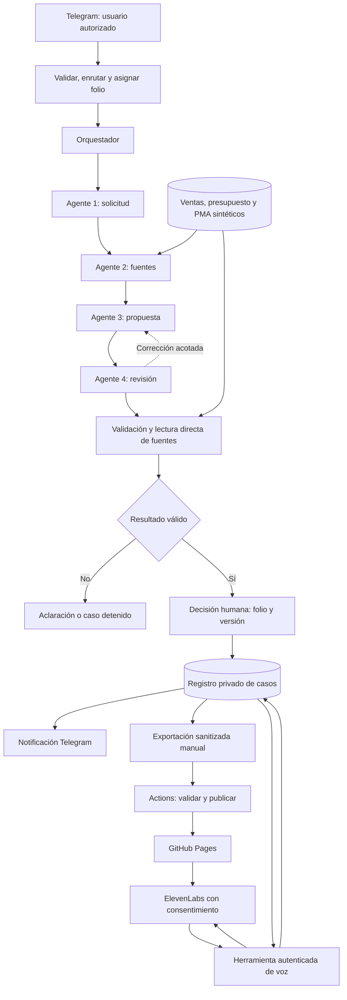

# Arquitectura Lincoln y estado de integración

Mapa del proceso objetivo solicitado por la guía. El export v04 y la ejecución53 acreditan el recorrido manual de cuatro agentes, lectura de fuentes y revisión determinista. Las rutas de canal, aprobación, corrección, exportación pública y voz deben revalidarse de extremo a extremo. Las flechas de este diagrama describen conexiones y responsabilidades; no certifican pruebas pendientes.

- **Comprobado en53:** extracción, fuentes, cálculo, revisión, validación determinista y registro pendiente.
- **Fuera de ese recorrido manual:** ingreso/aprobación/notificación real de Telegram y voz desde Pages.
- **Pendiente antes del modelo:** deduplicación compartida y reserva/control monetario por llamada.
- Las operaciones empresariales siguen simuladas; ninguna revisión autoriza pagos.
